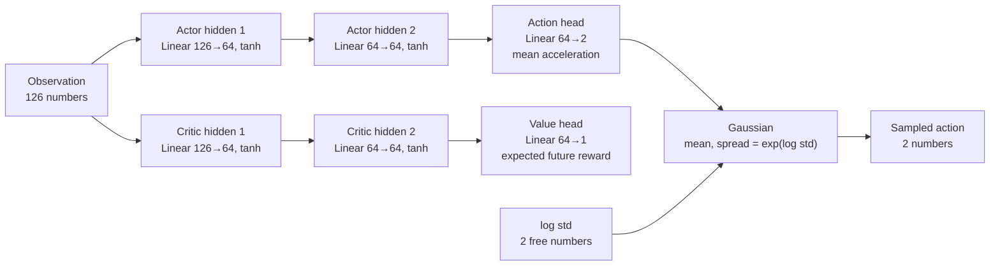
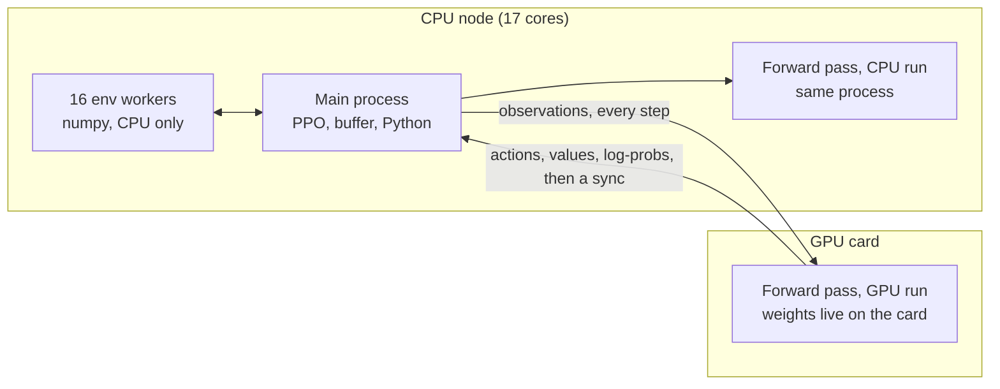

# PPO inner workings

How PPO training works in this project: what the network is, how reward turns into learning, where the training time goes, why a GPU does not help, and how runs could be shortened. Numbers refer to the Stage 4 setup: 3 drones, 2M environment steps, CPU batch job with 17 cores (16 environments × 128 steps per update). For the design, see [README.md](README.md); for experiment history, see [LOG.md](LOG.md).

## 1. The loop in one paragraph

PPO repeats two phases about 977 times in a 2M-step run:

1. **Collect data:** the current network flies the drones for a while.
2. **Learn from it:** adjust the network's weights so good actions become more likely, then discard the data and collect fresh data with the improved network.

## 2. What goes in and what comes out

**Inputs**

- **Observations:** each drone gets its own row of 126 numbers every step (velocity, waypoint direction, neighbour positions, rays, wall distances, searched map, and so on; README section 4.6).
- **Rewards:** after each step the environment gives each drone a reward (progress, exploration, penalties, bonuses; README section 5).

**Outputs**

- **An action per drone per step:** the network outputs an average acceleration (2 numbers) and a spread. During training the action is sampled around that average, which lets the policy try variations. In evaluation it uses the average.
- **A value estimate:** a second tower of the network (the critic, section 2.1) predicts how much reward is still to come from the current situation. PPO uses it to judge whether an action turned out better or worse than expected.
- **At the end, `model.zip`:** the trained network, which maps an observation to an action.

### 2.1 The network

`training.py` builds `PPO("MlpPolicy", ..., net_arch=[64, 64], log_std_init=-1.0)`. Observations have 126 numbers, actions have 2, and the activation is SB3's default (tanh). The result is **two separate towers** (an actor and a critic) that share no weights. All three drones use the same network. The numbers below were checked by building the policy with SB3 2.9.2 and counting its parameters.



| Part | Shape | Parameters (weights + biases) |
|---|---|---|
| Actor hidden layer 1 | 126 → 64 | 8,064 + 64 |
| Actor hidden layer 2 | 64 → 64 | 4,096 + 64 |
| Action head (mean) | 64 → 2 | 128 + 2 |
| Critic hidden layer 1 | 126 → 64 | 8,064 + 64 |
| Critic hidden layer 2 | 64 → 64 | 4,096 + 64 |
| Value head | 64 → 1 | 64 + 1 |
| `log_std` (the spread) | 2 free numbers, the same in every state | 2 |
| **Total** | 2 hidden layers of 64 neurons per tower | **24,773** (about 97 KiB in fp32) |

The actor has 12,418 parameters, the critic 12,353 and `log_std` 2. The network is small enough to sit in the CPU cache. One forward pass costs about 49 kFLOP per sample, so a minibatch of 768 costs about 38 MFLOP forward and about 113 MFLOP with the backward pass. An A100 does that in roughly 6 µs.

**What "[64, 64]" means.** It is SB3's list of hidden layer widths: two hidden layers, each with 64 neurons. It does not count the input or the output, and it is not a matrix size. The chain per tower is `126 inputs → 64 → 64 → output`, where the output is a separate small layer (`action_net` 64→2, `value_net` 64→1) that is not part of `net_arch`. The 126 is only the input size, and it shows up as the width of the first weight matrix (126 × 64 = 8,064 weights). Layer 2 happens to have a 64 × 64 weight matrix as well (4,096 weights), which is another reason the shorthand can look like a matrix size.

### 2.2 How the actor and critic interact

They are logically parallel and never feed into each other. Both read the same 126-number observation. The code runs them one after the other on a single thread (the actor tower, then the critic tower), but neither uses the other's output.

- **Actor (policy):** outputs the mean acceleration. SB3 builds a Gaussian around it with spread `exp(log_std)`, which starts at exp(−1) ≈ 0.37. Training samples from it. Evaluation uses the mean only, and the critic is not touched at all.
- **Critic (value):** outputs one number V, an estimate of the discounted reward still to come from this observation. It never touches the environment. It is a training aid.

They meet in two places:

1. **Between collection and learning.** The stored values V feed GAE (γ = 0.99, λ = 0.95), which turns them into one **advantage** per sample: how much better or worse the outcome was than the critic expected. The advantage is the only thing that tells the actor which direction to move.
2. **In one summed loss:** `loss = policy_loss + 0.5 × value_loss − 0.005 × entropy`. One backward pass then sends each term to its own parameters:

| Loss term | Updates |
|---|---|
| Policy loss | Actor layers and `log_std` |
| Value loss (critic's prediction vs the actual return) | Critic layers |
| Entropy bonus (keep exploring) | `log_std` only |

Adam then updates all 24,773 numbers in one step, but the two towers learn from different signals.

## 3. Samples, updates, epochs and gradient steps

### 3.1 Definitions

| Term | Meaning | Number in this project |
|---|---|---|
| Sample | One drone at one step: its observation, the action taken, the reward, the value estimate, and how likely that action was. All drones share one network, so one environment step gives 3 samples. | 3 per environment step |
| Rollout | The data collected before one update: 16 environments × 128 steps | 2,048 environment steps = 6,144 samples |
| Advantage | For each sample, how much better than expected things went. Computed with the discount (γ = 0.99) and the GAE factor (λ = 0.95). | One per sample |
| Update | One round of collect, score, optimise, then discard the data | 2M ÷ 2,048 ≈ 977 per run |
| Epoch | One pass over all 6,144 samples of a rollout, in shuffled order | 10 per update |
| Minibatch | A slice of the samples used for one gradient step (`ppo.batch_size`) | 768 samples; 8 per epoch (until 2026-11-15: 192 samples, 32 per epoch) |
| Gradient step | One small change of the network weights, computed from one minibatch | 8 × 10 = **80 per update** (until 2026-11-15: 32 × 10 = 320) |

What one gradient step does:

1. Run the 768 samples of the minibatch through the network.
2. Compute the loss:
   - a policy term: do more of what went better than expected, but clipped (`clip_range` 0.2) so one update cannot move the policy too far;
   - a value term: predict returns better;
   - a small entropy bonus (`ent_coef` 0.005): keep exploring.
3. Backpropagate.
4. Clip the gradient norm (0.5, the SB3 default), then let the Adam optimiser nudge the weights by an amount set by the learning rate (3e-4, falling linearly to 0 over the run in stages 3 to 5).

Other settings not set in `config.py`, so SB3 defaults apply: value-loss weight 0.5, advantages normalised per minibatch, no KL early stopping. Rewards are divided by a running standard deviation during training (`VecNormalize`, observations stay raw); reported returns are raw.

Note on counting: SB3 sees 16 × 3 = 48 rows per step and counts one timestep per drone row, so `total_timesteps` is passed as `run.timesteps × num_drones`.

### 3.2 The same thing as a sports team learning from video

The three drones are a team. The network is the team's playbook: a set of habits saying "in this situation, do this."

| PPO term | In the analogy |
|---|---|
| Sample | One frame of the video: one drone at one moment, what it saw, what it did, what happened next |
| Rollout | Play with the current playbook while a camera records: 6,144 frames of footage |
| Update | One "play, then review" cycle. Play, study the footage, improve the playbook, go back out. The old footage is thrown away, because it shows habits the team no longer has. |
| Epoch | Watching all the footage once. The team watches it 10 times, but a rule (clipping) forbids overhauling the playbook based on one tape. |
| Gradient step | The footage is cut into clips of 768 frames. After each clip the team makes one small correction: "in situations like these, lean a little more toward what worked and away from what didn't." |

```
Training run (2M steps)
└── 977 updates ("play, then review" cycles)
    ├── Play: collect 6,144 frames of footage
    └── Review: watch it 10 times (10 epochs)
        └── each viewing: 8 clips of 768 frames   (until 2026-11-15: 32 clips of 192)
            └── after each clip: 1 small correction (gradient step)
                → 80 corrections per review       (until 2026-11-15: 320)
```

### 3.3 How the reward turns into a weight update

**The reward is what makes this reinforcement learning, not the critic.** The agent learns from a reward signal that its own actions produce in the environment. The critic is an optional helper: REINFORCE has none, and some newer methods drop it too. In PPO it reduces the noise of the learning signal so training is steadier.

The path from reward to weights:

1. The environment's Python code computes a reward per drone per step (README section 5). `VecNormalize` rescales it for training.
2. After collection, GAE combines several steps of real rewards with the critic's own estimates at later steps into a return, and subtracts the critic's estimate V at the step in question. That difference is the advantage. It is a smoothed multi-step comparison, not "this one reward vs this one estimate."
3. The advantage is normalised within each minibatch, so what counts is how a sample compares with its neighbours.
4. In the policy loss, a positive advantage makes that action more likely in that situation, a negative advantage makes it less likely, and a larger magnitude means a larger push.
5. The clip (0.2) stops the probability of an action from changing by more than about 20% in one update. A reward far below the estimate therefore does not cause a drastic change.
6. At the same time the value loss pulls the critic's estimates toward the actual returns, so the advantages get better over the run.

Two common misreadings. First, the network does not "keep some weights the same and change others drastically": every sample nudges all weights slightly, in a direction set by its advantage, and the change is in what the policy does (action probabilities), not in individual weights. Second, the advantage is not a comparison of one reward with one estimate.

## 4. Why Python overhead dominates

One gradient step involves a few dozen PyTorch calls in Python: the network layers, log-probabilities, the probability ratio, clipping, the losses, the backward pass, gradient clipping and the Adam step. They expand into about 950 low-level ATen calls (many nested inside others). Each call has a fixed launch cost in Python and PyTorch's dispatcher, a few microseconds to tens of microseconds, regardless of the size of the data. The arithmetic itself is small: 192 samples through a 64-wide network take a fraction of a millisecond.

So most of the measured 0.83 s per update with 320 gradient steps (about 2.6 ms per step) is bookkeeping, not maths. In the analogy, every correction comes with a fixed amount of admin (rewind, pause, take notes, edit the playbook), and the clips were so short that the admin took longer than the watching. With clips of 768 frames (80 corrections) an update takes 0.28 s.

The two measured points (2.6 ms per step at 192 samples, 3.5 ms at 768) fit about 2.3 ms of fixed cost per step plus about 1.6 µs per sample. Quadrupling the data barely changed the time, which is the signature of an overhead-bound step.

### 4.1 What the time of one gradient step is spent on

Profiled with torch's profiler on a 2-core 2.1 GHz Xeon, one thread, minibatch 768, with the SB3 loss, gradient clipping, Adam and the scalar reads. One step took 3.08 ms (3.5 ms measured on the VSC). The percentages are indicative, not exact.

| Share of the step | What it is |
|---|---|
| about 28% | Matrix multiplies (`mm`, `addmm`): the real heavy arithmetic, forward and backward |
| about 9% | `tanh` forward and `tanh` backward |
| about 11% | Other element-wise maths and reductions (multiply, divide, add, sum, transpose) |
| about 9% | Copies, dtype conversions and memory allocation |
| about 21% | A long tail of tiny operations (Adam updates, gradient-norm clipping, `exp`, `clamp`, `min`, the losses), each below about 2% |
| about 23% | Outside the operators: Python code, autograd bookkeeping, optimiser loops, reading scalars back |

```
matrix multiplies   ██████████████                    ~28%
tanh                ████                              ~9%
other element-wise  █████                             ~11%
copies / allocation ████                              ~9%
long tail           ██████████                        ~21%
Python / autograd   ███████████                       ~23%
```

The matrix multiplies are the "about one third" that is real heavy arithmetic. Adding tanh and the element-wise maths, about half the step touches numbers, but those operators work on tiny tensors (768 × 64 floats), so their time is mostly per-call setup. The remainder is pure bookkeeping, paid once per call regardless of data size.

Consequences:

- **More torch threads do not help.** Measured on 2026-11-15: one update took 0.83 s with 1 thread and 0.89 s with 2. Threads speed up the arithmetic inside an operation, which is not the bottleneck. `training.py` therefore sets `torch.set_num_threads(1)`.
- **A GPU does not help** for the same reason, and adds a transfer to and from the card on every step (LOG 2026-11-14.5). Section 7 explains this in detail.
- **More cores help only the environment stepping,** which already runs in parallel processes.

## 5. Where the 25 to 35 minutes went (320 gradient steps per update)

Stage 4, 2M steps, 17 cores, minibatch 192:

| Part | Time | Notes |
|---|---|---|
| PPO updates (977 × about 1.0 s) | about 16 min | One process; cores cannot help |
| Environment stepping (977 × about 0.3 s with 16 environments) | about 5 min | Already parallel |
| Periodic evaluation during training (40 × 10 episodes, in the main process) | estimated 1 to 3 min | Not measured separately |
| Final evaluation (100 episodes × 3 policies), plots and GIFs | a few minutes | One process |

The updates are the floor: even with unlimited cores, training takes at least about 16 minutes. Reaching 10 to 15 minutes in total means making each update cheaper or doing fewer of them.

## 6. Options to bring a run down to 10 to 15 minutes

| # | Option | Expected effect | Changes learning? | Cost to adopt |
|---|---|---|---|---|
| 1 | Larger minibatches (`ppo.batch_size` 192 to 768) | 4× fewer gradient steps (80 instead of 320 per update); update about 0.25 s; training about 977 × (0.25 + 0.3) s ≈ 9 min | Yes: fewer, smoother steps; may need a higher learning rate | Validate on 2 to 3 Stage 4 seeds against 90% and 84% |
| 2 | Less periodic evaluation (`run.eval_freq` 50k to 250k, or 0) | Saves an estimated 1 to 3 min | No | None; progress is judged from `training_episodes.csv`, which is steadier anyway |
| 3 | Warm start from the previous stage's model | Stage 4 might need 0.5 to 1M steps instead of 2M (the Stage 3 model scored 48% on Stage 4 without obstacle training) | It changes the "every stage from scratch" setup | Small code addition (`--init-model`); fits the view that Stage 5 is the deliverable |
| 4 | Fewer epochs (`ppo.n_epochs` 10 to 5) | Halves the update time | Yes | Validation; do not combine with option 1 in the same test |
| 5 | Batched environment (all environments as one numpy array in one process) | Attacks only the 5-minute environment part | No | Large rewrite; not worth it now |

**Applied on 2026-11-15: option 1** (`ppo.batch_size` 768, so 80 gradient steps per update). Tested on the three Stage 3 and three Stage 4 seeds that had passed with 320 (LOG 2026-11-15.4):

- Stage 4 jobs now take 11 to 14 minutes in total (training 10.0 to 12.6 min, previously 18.7 to 25.8). Stage 3 training took 13.2 to 21.8 min (previously 21.5 to 26.4). Credits fell by about 40%.
- All six runs still pass the gate. Stage 3: 94%, 91%, 93% (before 94%, 95%, 93%). Stage 4: 84%, 87%, 83% (before 90%, 84%, 93%), a few points lower on average but within the noise of 100 episodes.
- **For the later stages it may be smart to go back to 320 gradient steps** (`--set ppo.batch_size=192`), or to test 384 (160 steps), for a potentially higher success rate at the cost of about 8 to 15 more minutes per run.

Options 2 to 5 have not been applied. With the cheaper update, the next limit is the main process during data collection: the jobs use only about 20% of their reserved cores, because the environment processes wait for the main process to gather observations, run the network and send back actions.

## 7. CPU vs GPU: what happens under the hood

The short version: a GPU would not speed this project up, because the work is limited by Python overhead and the CPU-side environment simulation, not by arithmetic. Estimates in this section are marked; the one hard measurement is the 50,000-step benchmark (LOG 2026-11-14.5): **627 environment steps/s on the GPU against 796 on the CPU**, about 21% slower.

### 7.1 The same process, told as a kitchen

Think of one cook (the Python main process) with a recipe book (the 24,773 weights). The 16 environment workers are 16 stoves running in the background. They are plain numpy, so they always run on the CPU.

**Phase 1, collect (128 times per cycle).** Each time, the stoves hand the cook 48 order slips (3 drones × 16 environments, each slip 126 numbers). The cook reads the recipe, writes back 48 two-number actions and a value guess per slip, and the stoves advance.

- **CPU run:** the cook reads the recipe at their own desk, which takes microseconds.
- **GPU run:** the recipe sits in a warehouse across town. Each time, the cook packs the 48 slips (about 24 KB), sends them over, waits for the warehouse to run the numbers, and waits for the answers. The warehouse does the work instantly, but the trip happens 128 times per cycle, about 125,000 times per run.

**Phase 2, learn (80 times per cycle).** The cook takes 768 saved slips and works through the roughly 950 small operations of section 4: score the actions, compute the loss, work backwards, nudge the weights.

- **CPU run:** all of it happens at the desk, about 3.5 ms per step.
- **GPU run:** the same forms and page-turning still happen at the desk, because only the cook can issue instructions, and each instruction also has to be mailed to the warehouse. The warehouse spends microseconds on each job and then sits idle until the next one arrives. After each step the cook also asks "what was the loss?", which forces a wait for the answer (SB3 reads a few scalars back to Python every minibatch).

### 7.2 Per cycle, side by side

| Step | CPU run | GPU run |
|---|---|---|
| Environments step | CPU | CPU (identical) |
| Observations to the network | stay in RAM | copied to the card, 128× per cycle |
| Forward pass | CPU, microseconds | on the card; actions, values and log-probs copied back, then a sync |
| Rollout buffer and advantage computation | CPU numpy | CPU numpy (identical) |
| Each minibatch of 768 | read directly | copied to the card first (about 387 KB), 80× per cycle |
| Loss, backward, Adam | CPU, about 3.5 ms per step | about 950 ATen calls launched from the same Python thread; about 3 ms per step (estimate) |
| Periodic evaluation | CPU | also runs the GPU forward on every step |



### 7.3 Time per gradient step (minibatch 768)

| Case | Fixed overhead | Arithmetic | Copy and sync | Total |
|---|---|---|---|---|
| CPU, minibatch 192 (measured) | about 2.3 ms | about 0.3 ms | none | 2.6 ms |
| CPU, minibatch 768 (measured) | about 2.3 ms | about 1.2 ms | none | 3.5 ms |
| GPU, minibatch 768 (estimate, not measured) | about 2.3 ms dispatch + about 0.6 ms CUDA launches | about 0.02 ms | about 0.2 ms | about 3.1 ms |

The GPU shrinks only the arithmetic column (about 1.2 ms to about 10 µs). Even in the best case that saves roughly 0.1 s of the 0.58 s cycle (about 15%), and the extra launches, uploads and per-step syncs eat most or all of it. The 0.3 s collection phase gets slower on a GPU, not faster. Hence the measured 21% slowdown.

### 7.4 Why the GPU is slower: the real reason

The usual intuition "the GPU has no Python interpreter" is true but is not the cause: Python runs only on the CPU in both setups, so its cost is the same. The GPU is slower because there is almost nothing for it to do on each launch. It executes the kernels that the CPU's Python thread launches one at a time, finishes each tiny one in microseconds, and then waits while the CPU does the per-call bookkeeping. Add the copies and syncs and the total comes out slower. A GPU loses to a CPU only when the work per launch is too small to amortise these costs, which is exactly the case for a network with 24,773 parameters.

### 7.5 What more GPUs would do (and the "8 × 256" run)

- **"8 × 256" means 8 environments × 256 steps.** Those 8 environments are numpy processes that always run on the CPU. GPUs cannot take them over; you still need 8 environment cores plus the main PPO process.
- **PPO here uses one network on one device.** SB3 has no multi-GPU support. Using 8 GPUs would need data-parallel training: one Python process per GPU, each driven by one CPU core. That matches the picture of a core running Python for each GPU, but each gradient step would also need a gradient exchange between the cards (an all-reduce). At about 3 ms per step this would make training slower, not faster.

### 7.6 When a GPU would pay off

- **A much bigger network or minibatch,** so the fixed overhead per step becomes small next to the arithmetic. That needs a network a few hundred times larger, or minibatches of tens of thousands of samples.
- **Less launch overhead:** CUDA graphs or `torch.compile` could collapse the roughly 950 calls per step into one launch. This is engineering effort, and it only attacks the update phase.
- **A GPU-resident environment:** the 0.3 s collection phase is the real remaining cost, so the simulator itself would have to be a batched GPU (or JAX) simulator. Option 5 in section 6 is the CPU version of the same idea.

## 8. Practical note: a new run folder does not appear in VS Code

A batch job creates its run folder within seconds of starting (for example, job 62704103 started at 11:32:00 and created `runs/20261115_113213_s4_mask` at 11:32:13). If it does not show up in the VS Code Explorer, the Explorer has not refreshed: changes made by a job on another node do not trigger VS Code's file watcher on the VSC data filesystem.

- Click the refresh icon at the top of the Explorer panel, or collapse and reopen `runs/`.
- `ls runs/` in the terminal always shows the real state.
- `squeue -M wice -u $USER` shows whether the job is running (`R`) or still queued (`PD`). A queued job has no folder yet.
- `python3 cluster/progress.py runs/<folder>` shows how far the training is.

---

*Written 2026-11-15; updated the same day after the minibatch change; extended 2026-11-19 with the network specification (section 2.1 and 2.2), the reward-to-update path (3.3), the profile of one gradient step (4.1) and the CPU vs GPU section (7). Section numbers 1 to 6 are unchanged, because LOG.md refers to them.*

*Project status at the time of writing:*

- *Repository: `main`, commit `8649c27` ("Made the individual seed runs even faster by decreasing gradient steps for every update from 320 to 80…"), which contains the `ppo.batch_size` 768 change.*
- *The network size and parameter count were checked by building the policy with SB3 2.9.2. The profile in 4.1 and the GPU row in 7.3 were run or estimated on a different CPU than the VSC, so they show proportions, not exact VSC timings.*
- *Curriculum: Stages 3 and 4 pass the gate on three seeds, both with 320 and with 80 gradient steps per update. Stage 5 has not been run with the current settings.*
