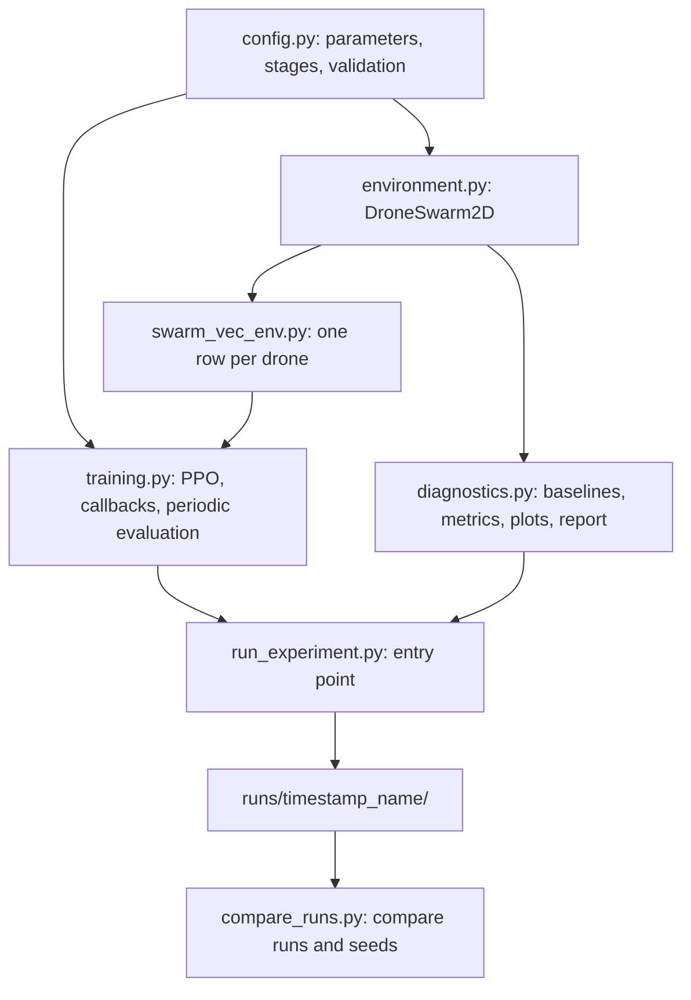

# Drone Swarm 2D

Three allied drones operate in a 10 × 10 m two-dimensional arena. The swarm must find a hidden target, fly to it together, and avoid walls, obstacles, and collisions with each other. One PPO policy, built with Stable-Baselines3, controls all three drones.

Experiment history, problems, and results are in [LOG.md](LOG.md). This file describes the design.

## 1. Research question

How do reward design and coordinated control affect the balance between mission completion, formation maintenance, and hazard avoidance in a small drone swarm?

## 2. Architecture



Code lives in the `drone-swarm-2d-martin-branch/` subfolder. This README sits in the parent folder.

## 3. Source files

| File | Responsibility |
|---|---|
| `config.py` | All tunable parameters, curriculum stages, CLI overrides, validation |
| `environment.py` | `DroneSwarm2D`: dynamics, observation, rays, search, rewards, collisions, success |
| `swarm_vec_env.py` | Exposes each drone as its own row so one shared policy trains on all drones |
| `training.py` | PPO construction, vectorised environments, training monitor, periodic evaluation |
| `diagnostics.py` | Random and Greedy policies, PPO evaluation, metrics, plots, GIFs, diagnosis, report |
| `run_experiment.py` | Entry point: configure, train, evaluate, save artifacts into a timestamped run folder |
| `compare_runs.py` | Summarises runs; runs sharing a name are treated as seeds |
| `requirements.txt` | Python dependencies |

## 4. Environment

### 4.1 World and drones

| Property | Value |
|---|---|
| Arena | Square, 10 × 10 m; walls at 0 and 10 |
| Drones | 3 per swarm, radius 0.15 m |
| Drone-drone collision | Centre distance below 0.30 m |
| Time step | 0.1 s |
| Speed and acceleration | Maximum 1.0 m/s and 1.0 m/s² |
| Episode limit | 800 steps |
| Start | Drones evenly spaced on a circle of radius `start_spread` (0.5 m) around the swarm centre |

Each step the acceleration updates velocity, velocity is clipped to the maximum speed, and position is updated. This is a simple kinematic model.

### 4.2 Actions

The action is a `(3, 2)` array in $[-1, 1]$: one two-component acceleration per drone, scaled by `max_accel`. Each drone's axes are rotated so that $+x$ points from that drone to the target. The frame is fixed at the moment of detection and is the world frame before then.

An optional coupling blends each drone's action toward the swarm mean: $a_i' = \bar{a} + \alpha (a_i - \bar{a})$, where $\alpha$ is `env.action_residual_scale`. The default $\alpha = 1$ gives independent actions.

### 4.3 Target and search

- In the full task the target is hidden and randomised each episode.
- A drone detects the target within `target_sense_range` (1.5 m). Once any drone detects it, the whole swarm knows its position.
- The searched map has 10 × 10 cells of 1 m. A cell counts as searched when its centre is within about 0.79 m of a drone. That is the sensing range minus half a cell diagonal, so a fully searched map guarantees detection.
- Before detection, the observation contains the searched map and a waypoint vector toward the unsearched cell nearest the centroid.
- Stages 1 and 2 set the sensing range to 20 m, so the target is known from the start.

### 4.4 Obstacles and walls

- The full task uses 3 to 5 random circular obstacles with radii 0.5 to 0.9 m, kept `obstacle_safe_margin` away from the start drones and the target.
- Touching an obstacle, a wall, or another drone ends the episode as a collision.
- Stage presets 1 to 3 disable obstacles. Walls are always active.

### 4.5 Success and termination

- Success: every drone is within `success_radius` (0.8 m) of the target on the same step, with no collision.
- An episode terminates on success or any collision. It is truncated at `max_steps`.
- Outcome labels: `success`, `obstacle`, `boundary`, `drone_collision`, `timeout`.

### 4.6 Vision and observation

Each drone has 7 rays spanning 120°, reaching 2.0 m, pointing along its velocity direction. A ray reports the nearest obstacle, wall, or drone, without identifying which.

Each drone receives one observation row. For three drones the row has 126 values; in general $15 + 2(n-1) + \text{rays} + 100$.

| Block | Size | Content |
|---|---|---|
| Velocity | 2 | Normalised by maximum speed, in the drone frame |
| Target vector | 2 | Zero until found; scaled by world size |
| Search waypoint vector | 2 | Zero once found; toward the waypoint cell |
| Other drones | 4 | Relative positions, nearest first, clipped to ±3 m and divided by 3 |
| Heading | 2 | cos and sin relative to the frame |
| Rays | 7 | Normalised by `vision_range`; 1.0 means nothing in range |
| Wall distances | 4 | Along the frame's +x, −x, +y, −y, divided by `vision_range` |
| Found flag | 1 | 1 once the target is found |
| Own position | 2 | Scaled to [−1, 1]; zero once found |
| Searched map | 100 | 1 = searched; zero once found |

The policy is a feed-forward network without memory. Obstacles outside the rays are forgotten; the searched map is the only record of past search.

## 5. Reward

Each term is computed per drone per step. The environment reports the mean over drones; training gives each drone its own reward.

| Term | What it measures | Default weight | Active |
|---|---|---|---|
| `progress` | Mean decrease in distance to the target | 2.0 | After detection |
| `exploration` | Newly searched cells, credit shared between drones | 2.0 | Before detection |
| `search_waypoint` | Decrease in centroid distance to the current waypoint | 1.0 | Before detection |
| `target_found` | One-time bonus on first detection | 70.0 | At detection |
| `cohesion` | Distance beyond the cohesion radius (2.0 m before detection, 1.0 m after) | 0.5 | Always |
| `formation` | Mean error of pairwise distances against the initial triangle | 0.75 | After detection |
| `separation` | Surface gap below 0.3 m | 1.0 | Always |
| `obstacle_proximity` | Clearance below 1.0 m | 1.0 | Always |
| `wall_proximity` | Clearance below 1.0 m from walls | 3.0 | Always |
| `step` | Constant cost per step | 0.01 | Always |
| `collision` | One-time penalty | 10.0 | On collision |
| `success` | One-time bonus | 50.0 | On success |

Current behaviour: the collision penalty applies to every drone, not only the one that crashed. See [LOG.md](LOG.md) for open items.

## 6. Learning setup

Defaults from `config.py`:

| Parameter | Default |
|---|---|
| Learning rate | 3e-4 |
| Environments | 4 (separate processes when above 1) |
| Steps per environment per update | 256 |
| Minibatch | 192 drone samples |
| Epochs | 10 |
| Discount, GAE lambda, clip range | 0.99, 0.95, 0.2 |
| Entropy coefficient | 0.005 |
| Initial log std | −1.0 |
| Network | MLP, hidden sizes [64, 64] |
| Reward normalisation | On during training; reported returns are raw |
| Device | `auto` (GPU if available, otherwise CPU) |

One update holds `n_steps × n_envs × num_drones` samples. `run.timesteps` counts environment steps, and SB3 counts one timestep per drone row.

These defaults differ from the reference Stage 1 runs documented in [LOG.md](LOG.md).

## 7. Curriculum

Stages are presets in `config.STAGES`. Each stage trains from scratch; there is no warm start.

| Stage | Tests | Target | Obstacles | Budget |
|---|---|---|---|---|
| `1_known_fixed` | Navigation and coordination in a fixed layout | Known, fixed | None | 300k |
| `2_known_random` | Random start and target | Known | None | 500k |
| `3_search` | Exploration with a hidden target | Hidden | None | 1M |
| `4_search_few_obstacles` | Search with 1 to 2 obstacles | Hidden | 1 to 2 | 1M |
| `5_full` | Everything randomised | Hidden | 3 to 5 | 3M |

Move to the next stage only after reliable performance across several training seeds. The proposed gate is about 80% success across at least three seeds.

## 8. Running

Run from the code folder with the project virtual environment active.

```bash
python run_experiment.py --list-params
python run_experiment.py --stage 1_known_fixed --timesteps 2000 --episodes 3 --no-gif --name smoke
python run_experiment.py --stage 3_search --name search --seed 42 \
  --hypothesis "Hidden-target search with a stricter searched map" \
  --set reward.formation_weight=0.5
python compare_runs.py --last 3 --md
```

Precedence, lowest to highest: `config.py` defaults, `--config` JSON file, `--stage`, `--timesteps`/`--seed`/`--name`/`--episodes`/`--hypothesis`, `--set section.name=value`.

Values for `--set` are JSON-like: use `true`/`false` for booleans and unquoted numbers.

## 9. Run outputs

Each run creates `runs/<timestamp>_<name>/`:

| File | Content |
|---|---|
| `report.md` | Summary, outcomes, reward breakdown, automatic diagnosis (read first) |
| `results.json` | Machine-readable summaries, confidence intervals, diagnosis |
| `config.json` | Authoritative parameters used in the run |
| `metadata.json` | Status, git commit, Python version, command |
| `model.zip` | Final PPO model |
| `training_episodes.csv` | One row per training episode, with `r_*` reward terms |
| `eval_curve.csv` | Periodic evaluation during training |
| `episode_metrics_ppo.csv`, `episode_metrics_baselines.csv` | Per-episode evaluation metrics |
| `trajectories.png`, `reward_breakdown.png`, `training_curves.png` | Plots |
| `episode_first.gif`, `episode_failure.gif` | Animations, unless `--no-gif` |
| `sb3_log/` | SB3 logs |

Evaluation uses the same episode seeds for Random, Greedy, and PPO, so the results are comparable.

## 10. Setup

- Install the packages in `requirements.txt` into a project virtual environment.
- Activate the environment and confirm `which python` and `$VIRTUAL_ENV` point to it before installing anything.
- Confirm imports for `torch`, `stable_baselines3`, `gymnasium`, and `matplotlib`.
- Cluster-specific setup is recorded in [LOG.md](LOG.md).

## 11. Known limitations

- Results rest on single training seeds; use several seeds before drawing conclusions.
- No periodic checkpoints or resume after interruption.
- The policy has no memory beyond the searched map.
- No automated unit or integration test suite.
- Multi-process training (`n_envs > 1`) is not validated on the cluster.
- The collision penalty applies to all drones; see [LOG.md](LOG.md).

## 12. Glossary

- **Episode:** one run from reset to success, collision, or time limit.
- **Return:** sum of reward over an episode. It is not a substitute for success rate.
- **Policy:** the neural network that maps observations to actions.
- **PPO:** a clipped policy-gradient algorithm.
- **Terminated vs truncated:** terminated means success or collision; truncated means the time limit was reached.
- **Deterministic evaluation:** the policy uses its mean action with no sampling noise.
- **Searched map:** a grid of cells marked once a drone has covered them.
- **Frame:** each drone's axes, rotated so that $+x$ points at the target after detection.
