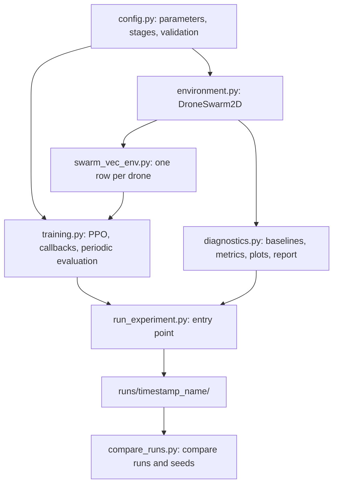

# Drone Swarm 2D

Three allied drones operate in a 10 × 10 m two-dimensional arena. The swarm must find a hidden target, fly to it together, and avoid walls, obstacles, and collisions with each other. One PPO policy, built with Stable-Baselines3, controls all three drones.

Experiment history, problems, and results are in [LOG.md](LOG.md). This file describes the design.

## 1. Research question

How do reward design and coordinated control affect the balance between mission completion, formation maintenance, and hazard avoidance in a small drone swarm?

## 2. Architecture



Code lives in the `drone-swarm-2d-martin-branch/` subfolder. This README sits in the parent folder.

## 3. Source files

| File | Responsibility |
|---|---|
| `config.py` | All tunable parameters, curriculum stages, CLI overrides, validation |
| `environment.py` | `DroneSwarm2D`: dynamics, observation, rays, search, rewards, collisions, success |
| `swarm_vec_env.py` | Exposes each drone as its own row so one shared policy trains on all drones |
| `training.py` | PPO construction, vectorised environments, training monitor, periodic evaluation |
| `diagnostics.py` | Random and Greedy policies, PPO evaluation, metrics, plots, GIFs, diagnosis, report |
| `run_experiment.py` | Entry point: configure, train, evaluate, save artifacts into a timestamped run folder |
| `compare_runs.py` | Summarises runs; runs sharing a name are treated as seeds |
| `requirements.txt` | Python dependencies |
| `cluster/setup_gpu_venv.sh` | Builds `.venv-gpu` with a CUDA build of torch |
| `cluster/train_cpu.slurm` | Slurm batch job for one training run on CPU cores (recommended) |
| `cluster/progress.py` | Shows how far a running training is |
| `cluster/train_gpu.slurm` | Slurm batch job for one training run on a GPU node |

## 4. Environment

### 4.1 World and drones

| Property | Value |
|---|---|
| Arena | Square, 10 × 10 m; walls at 0 and 10 |
| Drones | 3 per swarm, radius 0.15 m |
| Drone-drone collision | Centre distance below 0.30 m |
| Time step | 0.1 s |
| Speed and acceleration | Maximum 1.0 m/s and 1.0 m/s² |
| Episode limit | 800 steps |
| Start | Drones evenly spaced on a circle of radius `start_spread` (0.5 m) around the swarm centre |

Each step the acceleration updates velocity, velocity is clipped to the maximum speed, and position is updated. This is a simple kinematic model.

### 4.2 Actions

The action is a `(3, 2)` array in $[-1, 1]$: one two-component acceleration per drone, scaled by `max_accel`. Actions and observed vectors use a rotated frame whose $+x$ axis points at the current goal.

| Phase | Goal | Frame |
|---|---|---|
| Search (target hidden) | Search waypoint (section 4.3) | One frame shared by all drones. $+x$ points from the swarm centroid to the waypoint. Updated every step. |
| Approach (target found) | Target | One frame per drone. $+x$ points from that drone to the target. Fixed at the moment of detection. |

- "Accelerate along $+x$" is correct in both phases, so the policy does not have to read a direction from its observation.
- During search the frame is shared, so the same action moves the swarm as a body and keeps its shape. One frame per drone would make the drones converge on every waypoint.
- During search the frame follows the waypoint. A frame fixed when the waypoint is chosen keeps pointing along the old line after the swarm passes the waypoint without searching it.
- `env.waypoint_frame=false` uses world axes during search. PPO then ignores the waypoint (LOG 2026-11-14.10 and 2026-11-14.11).

An optional coupling blends each drone's action toward the swarm mean: $a_i' = \bar{a} + \alpha (a_i - \bar{a})$, where $\alpha$ is `env.action_residual_scale`. The default $\alpha = 1$ gives independent actions.

### 4.3 Target and search

- In the full task the target is hidden and randomised each episode.
- A drone detects the target within `target_sense_range` (1.5 m). Once any drone detects it, the whole swarm knows its position.
- The searched map has 10 × 10 cells of 1 m. A cell counts as searched when its centre is within about 0.79 m of a drone. That is the sensing range minus half a cell diagonal, so a fully searched map guarantees detection.
- Cells that cannot contain the target start as searched (`env.skip_targetless_cells`). A random target lies at least `edge_margin` (1 m) from every wall, so the 36 border cells hold nothing to find. The 64 remaining cells have centres at least 1.5 m from a wall. Searching a border cell would mean flying inside the wall-penalty zone (LOG 2026-11-14.9).
- Cells around random obstacles also start as searched (`env.skip_obstacle_cells`). A random target lies at least obstacle radius + `success_radius` + `obstacle_safe_margin` (r + 1.4 m) from each obstacle centre. A cell whose part inside the target area lies entirely within that distance of one obstacle holds nothing to find. This removes about 7 of the 64 cells per episode with 1 to 2 obstacles, and about 17 with 3 to 5. Without it the waypoint led the swarm into the obstacles (LOG 2026-11-14.21). The test is exact for one obstacle; a cell covered only jointly by two obstacles stays searchable, so a fully searched map still guarantees detection. It also means the searched map shows where the obstacles are from the first step.
- The search waypoint is the unsearched cell nearest the swarm centroid. It is kept until that cell is searched.
- Before detection, the observation contains the searched map and each drone's vector to the waypoint.
- Stages 1 and 2 set the sensing range to 20 m, so the target is known from the start.

### 4.4 Obstacles and walls

- The full task uses 3 to 5 random circular obstacles with radii 0.5 to 0.9 m, kept `obstacle_safe_margin` away from the start drones and the target.
- Touching an obstacle, a wall, or another drone ends the episode as a collision.
- Stage presets 1 to 3 disable obstacles; Stage 4 uses 1 to 2. Walls are always active.
- The search waypoint is chosen by straight-line distance and the frame points straight at it, also through an obstacle. Steering around is left to the policy (rays and `obstacle_proximity`).

### 4.5 Success and termination

- Success: every drone is within `success_radius` (0.8 m) of the target on the same step, with no collision.
- An episode terminates on success or any collision. It is truncated at `max_steps`.
- Outcome labels: `success`, `obstacle`, `boundary`, `drone_collision`, `timeout`.

### 4.6 Vision and observation

Each drone has 7 rays spanning 120°, reaching 2.0 m, pointing along its velocity direction. A ray reports the nearest obstacle, wall, or drone, without identifying which.

`env.rays_see_drones=false` makes the rays ignore other drones. In formation flight about 86% of ray hits are teammates, so the switch was tested in Stage 4. Obstacle crashes fell (4 and 7 against 9 and 10 per 100 episodes), but drone collisions rose (10 and 31 against 1 and 4) and success fell (86% and 61% against 90% and 84%): the rays are also the policy's close-range sensor for its neighbours. The default stays `true` (LOG 2026-11-14.22).

Each drone receives one observation row. For three drones the row has 126 values; in general $15 + 2(n-1) + \text{rays} + 100$.

| Block | Size | Content |
|---|---|---|
| Velocity | 2 | Normalised by maximum speed, in the frame of section 4.2 |
| Target vector | 2 | Zero until found; scaled by world size |
| Search waypoint vector | 2 | Zero once found; toward the waypoint cell |
| Other drones | 4 | Relative positions, nearest first, clipped to ±3 m and divided by 3 |
| Heading | 2 | cos and sin relative to the frame |
| Rays | 7 | Normalised by `vision_range`; 1.0 means nothing in range |
| Wall distances | 4 | Along the frame's +x, −x, +y, −y, divided by `vision_range` |
| Found flag | 1 | 1 once the target is found |
| Own position | 2 | Scaled to [−1, 1]; zero once found |
| Searched map | 100 | 1 = searched; zero once found |

The policy is a feed-forward network without memory. Obstacles outside the rays are forgotten; the searched map is the only record of past search.

`env.observe_search_map=false` replaces own position and the searched map with zeros. It is an ablation switch: hiding the map raised the found rate and lowered the success rate (LOG 2026-11-14.11).

## 5. Reward

Each term is computed per drone per step. The environment reports the mean over drones; training gives each drone its own reward.

| Term | What it measures | Default weight | Active |
|---|---|---|---|
| `progress` | Mean decrease in distance to the target | 2.0 | After detection |
| `exploration` | Newly searched cells, credit shared between drones | 2.0 | Before detection |
| `search_waypoint` | Decrease in the drone's own distance to the current waypoint | 2.0 | Before detection |
| `target_found` | One-time bonus on first detection | 70.0 | At detection |
| `cohesion` | Distance beyond the cohesion radius (1.0 m in both phases; `search_cohesion_radius` sets the value before detection) | 0.5 | Always |
| `formation` | Mean error of pairwise distances against the initial triangle | 0.75 (`search_formation_weight` before detection, `formation_weight` after) | Always |
| `separation` | Surface gap below 0.3 m | 1.0 | Always |
| `obstacle_proximity` | Clearance below 1.0 m | 1.0 | Always |
| `wall_proximity` | Clearance below 1.0 m from walls | 3.0 | Always |
| `step` | Constant cost per step | 0.01 | Always |
| `collision` | One-time penalty | 10.0 | On collision |
| `success` | One-time bonus | 50.0 | On success |

Formation and cohesion are shaped the same way in both phases, so the swarm reaches the target already grouped. When search let the swarm spread out, the formation penalty that started at detection was about five times the progress reward, and success after detection fell from 74% to 19% as the spread grew (LOG 2026-11-14.9). `search_waypoint` has the same form and weight as `progress`, so flying to the waypoint is rewarded like flying to the target.

Current behaviour: the collision penalty applies to every drone, not only the one that crashed. See [LOG.md](LOG.md) for open items.

## 6. Learning setup

Defaults from `config.py`:

| Parameter | Default |
|---|---|
| Learning rate | 3e-4 |
| Learning-rate schedule (`ppo.lr_schedule`) | `constant`; stages 3 to 5 set `linear` (falls to 0 over the run) |
| Environments | 4 (separate processes when above 1) |
| Steps per environment per update | 512 |
| Minibatch (`ppo.batch_size`) | 768 drone samples, so 80 gradient steps per update (192 and 320 until 2026-11-15) |
| Epochs | 10 |
| Discount, GAE lambda, clip range | 0.99, 0.95, 0.2 |
| Entropy coefficient | 0.005 |
| Initial log std | −1.0 |
| Network | MLP, hidden sizes [64, 64] |
| Reward normalisation | On during training; reported returns are raw |
| Device (`ppo.device`) | `auto` (GPU if visible, otherwise CPU); set `cpu` or `cuda` explicitly when benchmarking |

One update holds `n_steps × n_envs × num_drones` samples: 2,048 environment steps and 6,144 samples by default. `run.timesteps` counts environment steps, and SB3 counts one timestep per drone row.

**Gradient steps per update: 80, not 320.** Each update makes 10 passes (epochs) over its 6,144 samples, in minibatches of `ppo.batch_size`. With 768 that is 8 minibatches per epoch, so **80 gradient steps per update**. Until 2026-11-15 the minibatch was 192: 32 per epoch, 320 gradient steps.

- Why it changed: each gradient step has a fixed Python and PyTorch overhead that dominates the tiny [64, 64] network, so the update took about 0.83 s and was the floor of the training time. With 768 it takes about 0.28 s ([PPO_inner_workings.md](PPO_inner_workings.md)).
- Effect: a 2M-step run trains in 10 to 22 minutes instead of 19 to 26, at about 40% fewer credits. All three Stage 3 and all three Stage 4 seeds still pass the gate (LOG 2026-11-15.4). Stage 3 is unchanged (mean 93% against 94%); Stage 4 is a few points lower (mean 85% against 89%, within the noise of 100 episodes).
- **For the later stages it may be smart to go back to 320** (`--set ppo.batch_size=192`). The smaller steps scored slightly higher on Stage 4, and Stage 5 with 3 to 5 obstacles is likely to need every point. The price is about 8 to 15 more minutes of training per run.

Keep `n_envs × n_steps` at 2,048. With 1,024 an update holds about five Stage 3 episodes, and the result depended on the training seed: 33% to 88% (LOG 2026-11-14.12 and 2026-11-14.13).

These defaults differ from the reference Stage 1 runs documented in [LOG.md](LOG.md).

## 7. Curriculum

Stages are presets in `config.STAGES`. Each stage trains from scratch; there is no warm start.

| Stage | Tests | Target | Obstacles | Budget |
|---|---|---|---|---|
| `1_known_fixed` | Navigation and coordination in a fixed layout | Known, fixed | None | 300k |
| `2_known_random` | Random start and target | Known | None | 500k |
| `3_search` | Exploration with a hidden target | Hidden | None | 2M |
| `4_search_few_obstacles` | Search with 1 to 2 obstacles | Hidden | 1 to 2 | 2M |
| `5_full` | Everything randomised | Hidden | 3 to 5 | 3M |

Stages 3 to 5 also set `ppo.lr_schedule=linear`.

Move to the next stage only after reliable performance across several training seeds. The proposed gate is about 80% success across at least three seeds.

Status on 2026-11-15 (details in [LOG.md](LOG.md), entries 2026-11-14.8 to 2026-11-15.5):

| Stage | Status |
|---|---|
| `1_known_fixed` | 100% on one seed (2026-11-05); not re-run since |
| `2_known_random` | 100% on two seeds on 2026-11-05. On the current code two of three seeds fail (37% to 98%). Open issue, LOG 2026-11-14.15. |
| `3_search` | 94%, 93% and 95% on three seeds at 2M steps with 320 gradient steps per update; 94%, 91% and 93% with the current 80. Passes the gate. |
| `4_search_few_obstacles` | 90%, 84% and 93% on three seeds at 2M steps with 320 gradient steps per update (Greedy 92% to 93%); 84%, 87% and 83% with the current 80. Passes the gate. |
| `5_full` | Not run with the current settings |

## 8. Running

Run from the code folder with the project virtual environment active. On the VSC, run real training as batch jobs; see sections 10.2 to 10.4.

```bash
python run_experiment.py --list-params
python run_experiment.py --stage 1_known_fixed --timesteps 2000 --episodes 3 --no-gif --name smoke
python run_experiment.py --stage 3_search --name search --seed 42 \
  --hypothesis "Hidden-target search with a stricter searched map" \
  --set reward.formation_weight=0.5
python compare_runs.py --last 3 --md
```

Precedence, lowest to highest: `config.py` defaults, `--config` JSON file, `--stage`, `--timesteps`/`--seed`/`--name`/`--episodes`/`--hypothesis`, `--set section.name=value`.

Values for `--set` are JSON-like: use `true`/`false` for booleans and unquoted numbers.

## 9. Run outputs

Each run creates `runs/<timestamp>_<name>/`:

| File | Content |
|---|---|
| `report.md` | Summary, outcomes, crashes by phase (search or approach), reward breakdown, automatic diagnosis (read first) |
| `results.json` | Machine-readable summaries, confidence intervals, diagnosis |
| `config.json` | Authoritative parameters used in the run |
| `metadata.json` | Status, git commit, Python version, command |
| `model.zip` | Final PPO model |
| `training_episodes.csv` | One row per training episode, with `r_*` reward terms |
| `eval_curve.csv` | Periodic evaluation during training |
| `episode_metrics_ppo.csv`, `episode_metrics_baselines.csv` | Per-episode evaluation metrics |
| `trajectories.png`, `reward_breakdown.png`, `training_curves.png` | Plots. With random obstacles, `trajectories.png` has one panel per episode (rows = policies, columns = the first 4 evaluation episodes, the same layout per column), each with that episode's own obstacles and target. Without them, it overlays 12 episodes per policy. |
| `episode_first.gif`, `episode_failure.gif` | Animations of the first PPO evaluation episode and the first failed one, unless `--no-gif`. The episode is replayed from its seed and shows drones at true size, their rays (red = hit within range), the searched map (grey = no search needed, blue = searched), the waypoint (orange square) and the target (faint until found). About 1 MB each. |
| `sb3_log/` | SB3 logs |

Evaluation uses the same episode seeds for Random, Greedy, and PPO, so the results are comparable.

## 10. Setup

- Install the packages in `requirements.txt` into a project virtual environment.
- Activate the environment and confirm `which python` and `$VIRTUAL_ENV` point to it before installing anything.
- Confirm imports for `torch`, `stable_baselines3`, `gymnasium`, and `matplotlib`.
- Cluster-specific setup is recorded in [LOG.md](LOG.md) and in sections 10.1 to 10.5.

### 10.1 Two virtual environments

| Venv | torch build | Use on |
|---|---|---|
| `.venv` | `2.15.0+cpu` (no CUDA) | Any CPU session or CPU batch job. The default choice. |
| `.venv-gpu` | `2.15.0+cu132` (bundles its own CUDA 13.2 runtime) | GPU nodes with A100, H100, B200 or RTX 5000 Ada cards. Not P100/V100: CUDA 13 does not support them. |

Both use the `Python/3.13.5-GCCcore-14.3.0` module and the same package versions; only the torch build differs. `.venv-gpu` is built by `bash cluster/setup_gpu_venv.sh`, which needs no GPU and no CUDA module. In `.venv`, use `python -m pip`: its `pip` launcher is broken (LOG 2026-11-14.1).

Which device the PPO network uses is set by `ppo.device` (`auto`, `cpu`, `cuda`). Each run records its host, Slurm job, venv, torch build and GPU name in `metadata.json` under `hardware`.

### 10.2 Interactive session or batch job

Training can run in two places. Both write to the same `runs/` folder.

| | Interactive session | Batch job (`sbatch`) |
|---|---|---|
| What it is | A shell on a compute node that you type into | A script queued by Slurm; it runs on its own node without a terminal |
| CPU cores | 2 (limit of the `interactive` partition on wICE) | 9 by default (`cluster/train_cpu.slurm`); 17 recommended for Stage 4 and later (`--cpus-per-task=17`); up to 72 on a `batch` node |
| Parallel environments | `ppo.n_envs` 4 by default, which overloads the 2 cores | `ppo.n_envs = cores - 1` (8 with 9 cores, 16 with 17) |
| Measured training speed (Stage 3, minibatch 192) | about 800 environment steps/s | about 1,560 environment steps/s (9 cores) |
| Stage 3 preset (2M steps), whole job, minibatch 768 | not measured | 14 to 23 min, 310 to 500 credits (9 cores) |
| Stage 4 preset (2M steps), whole job, minibatch 768 | not measured | 11 to 14 min, 470 to 590 credits (17 cores) |
| Ends when | You close the terminal or the session times out | The job finishes, independent of your terminal |
| Use for | Editing code, smoke tests (`--timesteps 2000`), reading reports | Every real experiment, and several seeds at once |

**Why batch jobs were introduced.** The interactive session gives only 2 cores. Training time is spent mostly in simulating the drones, and each parallel environment (`ppo.n_envs`) is a separate process that needs its own core. A batch job can request more cores, so more environments step in parallel. With 9 cores, training runs about twice as fast as in the interactive session. Several jobs can also run at the same time, one per training seed.

**How they were added.**

| File | Role |
|---|---|
| `cluster/train_cpu.slurm` | New. Batch job on the wICE `batch` partition: 9 cores, 4 h limit, account `lp_deeplearning_gt_2026b`, `.venv`, `ppo.device=cpu`. Passes all its arguments to `run_experiment.py`. |
| `cluster/train_gpu.slurm` | New. The same for one A100 GPU (`gpu_a100` partition), with `.venv-gpu` and `ppo.device=cuda`. |
| `cluster/progress.py` | New. Prints how far a running training is (section 10.4). |
| `config.py`, `training.py` | New option `ppo.device`, used to choose CPU or GPU. |

`cluster/train_cpu.slurm` sets `ppo.n_envs` to the number of cores minus one; the remaining core runs PPO itself. It also sets `ppo.n_steps = 2048 / n_envs` (256 with 9 cores), so each PPO update still holds 2,048 environment steps, as with the defaults (4 × 512). More cores then make training faster without changing the amount of data per update. Until 2026-11-14 the script used 1,024 steps per update, which made Stage 3 depend on the training seed (LOG 2026-11-14.13). Any `--set` you pass overrides these values. The job also runs Python unbuffered (`python -u`), so its log file shows progress lines as they happen.

**Interactive run.** From the project folder in the interactive terminal:

```bash
cd /data/leuven/394/vsc39468/drone-swarm
source .venv/bin/activate
python run_experiment.py --stage 3_search --timesteps 2000 --episodes 3 --no-gif --name smoke --set ppo.n_envs=2
```

Use `ppo.n_envs=1` or `2` here so the processes do not exceed the 2 cores. Use the interactive session only for such smoke tests; real training runs as a batch job (section 10.3).

### 10.3 Running a batch job (recommended for training)

Every real training run goes through `sbatch cluster/train_cpu.slurm`, not through `python run_experiment.py` in the interactive terminal. You do not activate a venv or start Python yourself: the script loads the Python module, activates `.venv`, sets `ppo.device=cpu`, `ppo.n_envs` and `ppo.n_steps` from the core count, and calls `run_experiment.py`.

Step by step:

1. Open any terminal on the VSC (the interactive session is fine) and go to the project folder:

   ```bash
   cd /data/leuven/394/vsc39468/drone-swarm
   ```

2. Submit. Options for Slurm (`--cpus-per-task`, `--time`) go **before** the script name; everything **after** it goes to `run_experiment.py` (`--stage`, `--name`, `--seed`, `--episodes`, `--no-gif`, `--set ...`).

   ```bash
   # Stage 3: 9 cores (the script default)
   sbatch --time=00:50:00 cluster/train_cpu.slurm --stage 3_search --name search --seed 43 --episodes 100 --no-gif

   # Stage 4: 17 cores
   sbatch --cpus-per-task=17 --time=00:50:00 cluster/train_cpu.slurm \
          --stage 4_search_few_obstacles --name s4 --seed 42 --episodes 100
   ```

   Leave out `--no-gif` to get `episode_first.gif` and `episode_failure.gif` (about 1 minute more). `sbatch` prints the job ID; the job's console output goes to `slurm-<jobid>.out` in the project folder.

3. Three seeds at once, one job each. Runs that share a `--name` are grouped as seeds by `compare_runs.py`:

   ```bash
   prev=""
   for s in 42 43 44; do
     prev=$(sbatch --parsable --cpus-per-task=17 --time=00:50:00 ${prev:+--dependency=after:${prev%%;*}+1} \
            cluster/train_cpu.slurm --stage 4_search_few_obstacles --name s4 --seed $s --episodes 100)
   done
   ```

4. Follow the jobs (section 10.4), then read `runs/<timestamp>_<name>/report.md`. Compare seeds with `python compare_runs.py --last 3 --md` (with `.venv` active).

5. To use 320 gradient steps per update instead of the default 80 (section 6), add `--set ppo.batch_size=192` after the script name.

Run folders are named by start time to the second. Two jobs with the same `--name` that start in the same second would create the same folder, and the second one fails. The `--dependency=after:<jobid>+1` option starts each job at least one minute after the previous one has started. Jobs with different names need no chain.

Options for `sbatch` go before the script name, for example `sbatch --cpus-per-task=17 --time=08:00:00 cluster/train_cpu.slurm ...`; `ppo.n_envs` and `ppo.n_steps` follow the core count automatically. `sbatch --test-only cluster/train_cpu.slurm ...` shows the estimated start time without submitting.

More cores give diminishing returns. The PPO gradient update runs in one process whatever the core count (about 1 s per update with minibatch 192, about 0.3 s with 768); only the environment stepping is parallel. Stage 4, 200k-step benchmark with minibatch 192 (LOG 2026-11-14.23):

| Cores | `n_envs` × `n_steps` | Environment steps/s | 2M steps of training | Core-minutes for 2M steps |
|---|---|---|---|---|
| 9 | 8 × 256 | 1,287 | about 26 min | about 234 |
| 17 | 16 × 128 | 1,606 | about 21 min | about 357 |
| 33 | 32 × 64 | 1,911 | about 17.5 min | about 577 |

The Stage 4 runs used `--cpus-per-task=17`: 25% faster than 9 cores for about 1.5 times the credits. 33 cores costs 2.5 times the credits for 1.5 times the speed, and its 64-step rollout segments are untested. The script default stays at 9.

The jobs use only about 20% of the cores they reserve (`seff <jobid>`). Each environment step costs under 1 ms; the environment processes then wait for the main process, which gathers the observations, runs the network and sends the actions back. With minibatch 768 this per-step work in the main process is the bottleneck, so more cores would not make runs faster (LOG 2026-11-15.4).

Each job writes its console output to `slurm-<jobid>.out` in the project folder and its results to `runs/<timestamp>_<name>/`. The run folder is printed as `/vsc-hard-mounts/leuven-data/...`: that is the real path behind `/data/leuven/...`, which is a symbolic link to it. It is the same folder.

### 10.4 Tracking progress

Check whether the job is queued (`PD`) or running (`R`):

```bash
squeue -M wice -u $USER
```

See how far the training is:

```bash
python3 cluster/progress.py              # newest run in runs/
python3 cluster/progress.py runs/<folder> # a specific run
watch -n 30 python3 cluster/progress.py  # refreshes every 30 s, Ctrl+C to stop
```

Example output:

```text
20261114_190757_search  [running]
  progress  703,488/1,000,000 env steps (70.3%)
  time      7.5 min elapsed, ~3.2 min left in training (evaluation and report follow)
  training  success 44% in the last rollout
  eval      success 50% at the latest periodic evaluation
```

The script reads `runs/<folder>/sb3_log/progress.csv`, which SB3 updates after every PPO update. SB3 counts one timestep per drone, so the script divides by the number of drones to report environment steps. It uses only the standard library and needs no venv. The full console output can be followed with `tail -f slurm-<jobid>.out`. A job is cancelled with `scancel -M wice <jobid>`.

### 10.5 GPU training (optional)

For this project, CPU batch jobs are faster than GPU training. The policy is a small MLP ([64, 64]) and most of the time goes to simulating the drones, which always runs on the CPU. On the GPU, each step adds a transfer to and from the card, and the work per step is too small to make up for it. In a 50,000-step benchmark the GPU run trained at 627 environment steps/s against 796 on CPU (LOG 2026-11-14.5). A GPU becomes worthwhile only with much larger networks or a batched GPU environment.

To try it anyway, open an interactive GPU session on the `mindwell` cluster from the CPU terminal. The `env -u ...` part removes the Slurm variables of the current CPU session; otherwise `srun` would try to run inside that session instead of requesting a new one.

```bash
env -u SLURM_JOB_ID -u SLURM_JOBID -u SLURM_STEP_ID -u SLURM_STEPID -u SLURM_NTASKS -u SLURM_NNODES \
    -u SLURM_JOB_NODELIST -u SLURM_JOB_PARTITION -u SLURM_CLUSTER_NAME -u SLURM_CLUSTERS \
    srun --clusters=mindwell --partition=interactive --account=lp_deeplearning_gt_2026b \
    --nodes=1 --ntasks=1 --cpus-per-task=1 --gpus-per-node=1 --time=02:00:00 --pty /bin/bash -l
export TERM=xterm-256color
```

`export TERM=xterm-256color` makes the new shell's terminal display and keys work correctly. This session has one NVIDIA RTX 5000 Ada GPU and, as written, 1 CPU core. Raise `--cpus-per-task` (for example to 4) or set `ppo.n_envs=1`, otherwise the environment processes compete for one core.

In the GPU shell:

```bash
cd /data/leuven/394/vsc39468/drone-swarm
module load Python/3.13.5-GCCcore-14.3.0
source .venv-gpu/bin/activate
export XDG_CACHE_HOME=$VSC_SCRATCH/.cache MPLCONFIGDIR=$VSC_SCRATCH/.cache/matplotlib
python -c "import torch; print(torch.__version__, torch.cuda.is_available(), torch.cuda.get_device_name(0))"
python run_experiment.py --stage 3_search --name search_gpu --seed 42 --no-gif --set ppo.device=cuda
```

The check should print `2.15.0+cu132 True NVIDIA ...`. The `export` line avoids matplotlib cache warnings: the GPU session has no writable `$HOME/.cache`.

As a batch job on a wICE A100 instead: `sbatch cluster/train_gpu.slurm --stage 3_search --name search_gpu --seed 42 --no-gif`. A100 jobs can wait many hours in the queue.

## 11. Known limitations

- Stage 3 results rest on three seeds at 2M steps and five at 1M; other stages on one to three. Use several seeds before drawing conclusions.
- Stage 2 does not reproduce its earlier 100% on the current code: two of three seeds end with the swarm hovering just outside the success radius (LOG 2026-11-14.15).
- About 5% of Stage 3 episodes end in a drone collision, most of them during the final approach to the target.
- Stage 4 rests on three seeds. Stage 5 has not been run with the current settings.
- Rays do not report what they hit. Keeping other drones in the rays is supported by experiment (section 4.6); labelling each hit as drone or obstacle/wall is an untested idea for Stage 5.
- The search frame points straight at the waypoint, also through obstacles. The remaining Stage 4 failures (about 10%) are mostly obstacle crashes during search, as for the obstacle-blind Greedy (LOG 2026-11-14.22).
- Models trained before 2026-11-14 keep the same observation size (126) but were trained with a different frame and map, so they cannot be evaluated in the current environment.
- No periodic checkpoints or resume after interruption.
- The policy has no memory beyond the searched map.
- No automated unit or integration test suite.
- Run folders are named by start time to the second; same-name jobs that start in the same second collide (section 10.3).
- The collision penalty applies to all drones; see [LOG.md](LOG.md).

## 12. Glossary

- **Episode:** one run from reset to success, collision, or time limit.
- **Return:** sum of reward over an episode. It is not a substitute for success rate.
- **Policy:** the neural network that maps observations to actions.
- **PPO:** a clipped policy-gradient algorithm.
- **Terminated vs truncated:** terminated means success or collision; truncated means the time limit was reached.
- **Deterministic evaluation:** the policy uses its mean action with no sampling noise.
- **Searched map:** a grid of cells marked once a drone has covered them. Cells that cannot contain the target start as marked.
- **Waypoint:** the unsearched map cell nearest the swarm centroid; the swarm's current search goal.
- **Frame:** the rotated axes used for observed vectors and actions. $+x$ points at the current goal: the waypoint during search (one shared frame), the target after detection (one frame per drone). See section 4.2.
- **Found rate:** share of episodes in which the target is detected.
- **Conversion:** share of the episodes with the target found that end in success.
